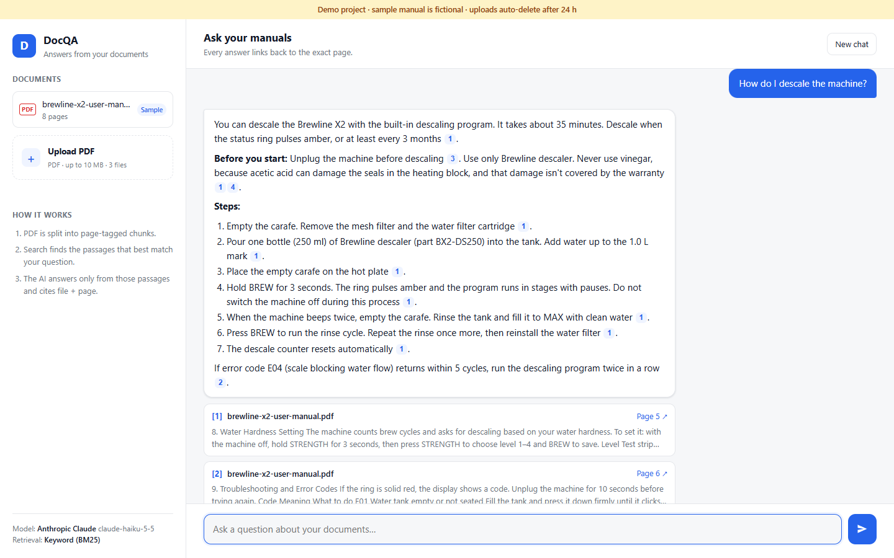

# DocQA — Ask Your Manuals (demo project)

> **Demo / portfolio project.** The preloaded "Brewline X2" coffee maker manual is a fictional document made for this demo. Uploaded files are private to your browser session and auto-delete after 24 hours.

Upload PDF manuals, ask questions in plain English, and get short answers that **cite the exact file and page**. Click a citation to open the PDF on that page.



## Case study

**Problem.** Support teams, technicians and customers lose time digging through long PDF manuals. Generic chatbots make things up, and nobody can check where an answer came from.

**What it does.**
- Upload PDFs (or use the preloaded sample) and ask questions in a chat.
- Answers come only from the documents. Every fact has a numbered citation linked to file + page.
- If the answer is not in the documents, it says so instead of guessing.
- Hybrid search (keyword BM25 + Gemini embeddings, merged with reciprocal rank fusion) finds exact part numbers and error codes *and* questions phrased in different words.
- Runs without any API key in "search-only" mode, which returns the best passages with citations.
- Demo guard rails: per-session documents, upload size/file limits, hourly question limit per IP.

**Stack.** Python · FastAPI · pypdf · NumPy (local vector store, no database) · Google Gemini (`gemini-flash-latest` + `gemini-embedding-001`) or Anthropic Claude as a drop-in · vanilla HTML/CSS/JS (no build step) · Docker (Hugging Face Spaces / Render).

**Result.** One small codebase (~500 lines) that a business can point at its own manuals, SOPs or policy documents. Typical answer time is 1–3 s and cost is a fraction of a cent per question on Gemini Flash.

## How it works

```
PDF ──► extract text per page ──► drop headers/footers ──► ~1500-char chunks (page-tagged)
                                                              │
                                    BM25 index  ◄─────────────┤
                                    embeddings (.npy) ◄───────┘
question ──► BM25 top-50 + vector top-50 ──► rank fusion ──► top 6 passages
         ──► LLM with "answer only from these, cite [n]" ──► answer + source cards
```

| File | Job |
|---|---|
| `app/rag.py` | PDF ingest, chunking, BM25 + vector hybrid search |
| `app/llm.py` | Gemini / Claude calls, embeddings, prompt, search-only fallback |
| `app/main.py` | FastAPI routes, sessions, limits, sample preload |
| `static/` | Chat UI (no framework) |
| `samples/make_sample.py` | Builds the fictional sample manual PDF |

## Run locally (Windows)

```powershell
cd "E:\AI Portfolio\doc-qa-bot"
.\run.ps1
```

First run makes a `.venv`, installs packages and creates `.env`. Put your key in `.env`:

```
GEMINI_API_KEY=your-key-here
```

Get a free key at <https://aistudio.google.com/apikey>. Restart, then open <http://localhost:8000>.
No key? It still runs in search-only mode. Claude works too: set `ANTHROPIC_API_KEY` instead.

**Local test with a Claude subscription (no API key):** if the `claude` CLI is installed and logged in, set `LLM_PROVIDER=claude-cli` in `.env`. Answers go through Claude Haiku via the CLI (~8–12 s each). Local only — the deployed demo needs `GEMINI_API_KEY` or `ANTHROPIC_API_KEY`.

Mac/Linux: `python -m venv .venv && .venv/bin/pip install -r requirements.txt && .venv/bin/uvicorn app.main:app --port 8000`

## Deploy (free)

### Option A — Hugging Face Spaces (recommended: free, no sleep delay for light traffic)
1. Sign in at huggingface.co → **New Space**.
2. Name it `doc-qa-bot`, SDK **Docker**, template **Blank**, hardware **CPU basic (free)**, visibility **Public**.
3. Upload all project files (drag and drop in **Files → Add file → Upload files**), or push with git:
   ```
   git clone https://huggingface.co/spaces/<your-user>/doc-qa-bot
   ```
   copy the project files in (not `.venv`, `data`, `.env`), then `git add . && git commit -m "init" && git push`.
4. **Settings → Variables and secrets → New secret**: `GEMINI_API_KEY` = your key.
5. Wait for the build (2–4 min). Your demo is at `https://huggingface.co/spaces/<your-user>/doc-qa-bot`.

### Option B — Render
1. Push the project to a GitHub repo.
2. render.com → **New → Blueprint** → pick the repo (it reads `render.yaml`).
3. Enter `GEMINI_API_KEY` when asked → **Apply**.
4. Free plan sleeps after 15 min idle; the first visit after that takes ~1 min.

## Settings (`.env`)

| Variable | Default | Meaning |
|---|---|---|
| `GEMINI_API_KEY` | – | Gemini key (answers + embeddings) |
| `ANTHROPIC_API_KEY` | – | Used if no Gemini key |
| `GEMINI_MODEL` | `gemini-flash-latest` | Answer model |
| `CLAUDE_MODEL` | `claude-haiku-5-5` | Answer model when using Claude |
| `ASKS_PER_HOUR` | 40 | Questions per IP per hour |
| `MAX_UPLOAD_MB` / `MAX_FILES_PER_SESSION` | 10 / 3 | Upload limits |

## Adapting it for a real client

- Swap the sample manual for their PDFs (or load a folder at startup).
- Add login, a real vector DB (pgvector, Qdrant) for thousands of documents, OCR for scanned PDFs.
- Embed the chat as a widget on their site, or connect it to Slack / WhatsApp / a help desk.
- For private company data, use a paid API tier (no training on data) and keep files in their own cloud.

---
Portfolio demo project. Not affiliated with any real appliance brand.
